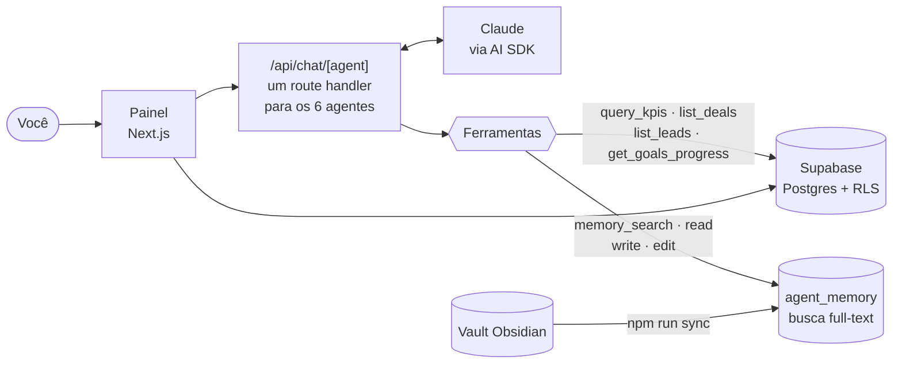

# BORG Business OS

**Um painel de gestão com 6 agentes de IA especializados e memória de longo prazo, feito para quem toca um negócio sozinho.**

Vendas, pipeline, metas, roadmap e matemática do negócio num só lugar, e seis "colegas" de IA (Gestão, Metas, Marketing, Aquisição, Ads e Estratégia) que conhecem o negócio porque leem a mesma memória e os mesmos números que você.

> Construí o BORG OS para gerir o meu próprio negócio. Esta versão pública usa um **negócio fictício de exemplo** ("Lumen", um app de reservas para estúdios de yoga). Para usar com o seu, edite um único arquivo: [`src/config/negocio.ts`](src/config/negocio.ts).

---

## Os 6 agentes

| Agente | Para que serve | Base metodológica |
|---|---|---|
| **Gestão** | Organizar a semana, decidir o que fazer a seguir | G4 (tração, rituais), EOS/Traction, caixa a 13 semanas |
| **Metas** | OKRs, scorecard semanal, accountability | OKRs (Doerr/G4), árvore de KPIs, cadência semanal |
| **Marketing** | Posicionamento, conteúdo, marca | April Dunford, StoryBrand, founder brand |
| **Aquisição** | Prospecção, mensagens, reuniões, follow-up | Seeds/Nets/Spears, BANT, SPIN, cadências |
| **Ads Manager** | Meta Ads e Google Ads com matemática | Advantage+, Search, ROAS/CAC/LTV |
| **Estrategista** | Nicho, preço, roadmap, trade-offs | ERRC/Blue Ocean, preço por valor, escada de valor |

Cada agente tem a sua personalidade e metodologia, mas todos seguem duas regras:
- **Nunca inventam números.** MRR, pipeline, leads e metas vêm sempre das ferramentas de dados (`query_kpis`, `list_deals`, `list_leads`, `get_goals_progress`), que leem o banco.
- **Nunca inventam fatos do negócio.** Antes de responder, procuram na memória (`memory_search`, `memory_read`) e citam as notas que usaram. O que aprendem fica guardado (`memory_write`, `memory_edit`).

## O painel

| Tela | O que mostra |
|---|---|
| **Início** | KPIs: MRR, receita, CAC, funil de conversão e evolução da receita |
| **Pipeline** | Leads e negócios em andamento, com estado e próximos passos |
| **Metas** | OKRs e metas com progresso |
| **Roadmap** | O que está planejado, em andamento e feito |
| **Memória** | Busca nas notas do negócio (as do vault Obsidian e as dos agentes) |
| **Agentes** | Chat com cada um dos 6 agentes, com respostas em streaming |

## Como funciona



- **Um único route handler** atende os 6 agentes. Cada um é só uma configuração (persona, notas-âncora, ferramentas), sem framework de orquestração: padrões simples e combináveis, como a Anthropic recomenda.
- **Memória = notas Markdown.** O vault do Obsidian é a fonte da verdade. O `npm run sync` sincroniza o vault com a tabela `agent_memory` (sincronização em 3 vias, com manifesto de hashes), e os agentes buscam o contexto quando precisam, com busca full-text em português. Para o volume de um negócio pequeno (centenas de notas), isso funciona melhor e é mais simples do que embeddings.
- **O vault humano é só leitura para os agentes.** Eles escrevem apenas na própria pasta (`09 - Agentes/<agente>/`), e a edição humana sempre prevalece.
- **Uma só verdade para as métricas.** As fórmulas (`src/lib/metrics/formulas.ts`) e as views SQL (`v_mrr_atual`, `v_pipeline_resumo`, `v_funil_conversao`, `v_progresso_metas`) são usadas tanto pelo painel quanto pelos agentes.
- **Prompt caching.** O system prompt de cada agente é um bloco estável (identidade + regras + persona); o contexto que muda entra como mensagem separada. Isso reduz o custo de cada conversa várias vezes.
- **Modelos:** Claude Sonnet para os agentes do dia a dia e Claude Opus para o Estrategista, onde as decisões pesam mais.

> A memória segue o mesmo método que eu uso em todos os meus projetos e que expliquei no tutorial [**Memória de IA com Obsidian**](https://github.com/guiboorges/memoria-ia-obsidian).

## Adaptar ao seu negócio

Tudo o que é específico do negócio está em [`src/config/negocio.ts`](src/config/negocio.ts): nome, o que vende, para quem, preço, alternativas da concorrência, diferencial, a meta do ano e as notas do vault que cada agente lê primeiro. Os 6 agentes, o painel e a tela de login leem daí.

As bases de conhecimento em [`knowledge/`](knowledge/) (metodologia G4 e frameworks por agente) são copiadas para o vault com `npm run seed:knowledge`.

## Segurança

- **As chaves ficam só no `.env.local`**, que nunca vai para o git. O [`.env.example`](.env.example) lista o que é preciso.
- A chave `service_role` do Supabase só é usada no servidor (route handlers e scripts), nunca no navegador.
- **O banco foi feito para um único usuário:** as políticas de RLS deixam qualquer usuário autenticado ver tudo. Por isso, o [SETUP](SETUP.md) manda **desativar os cadastros públicos** no Supabase. Se for usar com uma equipe, reveja as políticas em `supabase/migrations/0006_rls.sql`.

## Começar

O passo a passo completo (Supabase, Anthropic, migrações, memória e deploy na Vercel) está no [**SETUP.md**](SETUP.md).

```bash
npm install
cp .env.example .env.local   # preencha as chaves
npm run dev                  # http://localhost:3000
```

| Comando | O que faz |
|---|---|
| `npm run dev` | Servidor local |
| `npm run sync` | Sincroniza o vault Obsidian com o Supabase (`npm run sync:dry` para simular) |
| `npm run seed:knowledge` | Copia as bases de conhecimento para o vault |
| `npm run import:leads` | Importa planilhas Excel de prospecção (simulação; `-- --commit` para gravar) |

## Stack

Next.js 16 (App Router) · React 19 · TypeScript · Tailwind · Supabase (Postgres, Auth, RLS) · Vercel AI SDK com Claude · Recharts · Zod

---

### In English

**BORG Business OS** — a business dashboard with six specialised AI agents (Operations, Goals, Marketing, Acquisition, Ads and Strategy) and long-term memory, built for solo founders. The agents never invent numbers (they query KPIs, pipeline and goals through tools backed by Supabase views) and never invent business facts (they search an Obsidian vault synced to Postgres full-text search, cite their notes and write what they learn to their own folder). One parameterised Next.js route handler serves all six agents with stable, cache-friendly system prompts. I built it for my own business; this public version uses a fictional example business — everything business-specific lives in [`src/config/negocio.ts`](src/config/negocio.ts).
