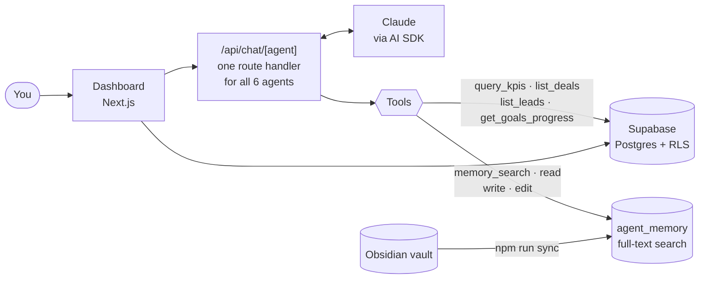

# BORG Business OS

[](https://github.com/guiboorges/borg-business-os/actions/workflows/ci.yml) [](https://github.com/guiboorges/borg-business-os/releases/latest) [](LICENSE)

**A management dashboard with 6 specialised AI agents and long-term memory, built for people who run a business on their own.**

Sales, pipeline, goals, roadmap and business maths in one place, plus six AI "colleagues" (Operations, Goals, Marketing, Acquisition, Ads and Strategy) who know the business because they read the same memory and the same numbers you do.

> I built BORG OS to run my own business. This public version uses a **fictional example business** ("Lumen", a booking app for yoga studios). To use it with yours, edit a single file: [`src/config/business.ts`](src/config/business.ts).

---

## The 6 agents

| Agent | What it's for | Methodology |
|---|---|---|
| **Operations** | Organising the week, deciding what to do next | G4 (traction, rituals), EOS/Traction, 13-week cash forecast |
| **Goals** | OKRs, weekly scorecard, accountability | OKRs (Doerr/G4), KPI tree, weekly cadence |
| **Marketing** | Positioning, content, brand | April Dunford, StoryBrand, founder brand |
| **Acquisition** | Prospecting, messages, meetings, follow-up | Seeds/Nets/Spears, BANT, SPIN, cadences |
| **Ads Manager** | Meta Ads and Google Ads, backed by maths | Advantage+, Search, ROAS/CAC/LTV |
| **Strategist** | Niche, pricing, roadmap, trade-offs | ERRC/Blue Ocean, value-based pricing, value ladder |

Each agent has its own personality and methodology, but they all follow two rules:
- **They never invent numbers.** MRR, pipeline, leads and goals always come from the data tools (`query_kpis`, `list_deals`, `list_leads`, `get_goals_progress`), which read the database.
- **They never invent business facts.** Before answering, they search the memory (`memory_search`, `memory_read`) and cite the notes they used. What they learn gets saved (`memory_write`, `memory_edit`).

## The dashboard

| Screen | What it shows |
|---|---|
| **Overview** | KPIs: MRR, revenue, CAC, conversion funnel and revenue over time |
| **Pipeline** | Leads and deals in progress, with status and next steps |
| **Goals** | OKRs and goals with progress |
| **Roadmap** | What's planned, in progress and done |
| **Memory** | Search across the business notes (from the Obsidian vault and from the agents) |
| **Agents** | Chat with each of the 6 agents, with streaming responses |

## How it works



- **A single route handler** serves all 6 agents. Each one is just a configuration (persona, anchor notes, tools), with no orchestration framework: simple, composable patterns, as Anthropic recommends.
- **Memory = Markdown notes.** The Obsidian vault is the source of truth. `npm run sync` syncs the vault with the `agent_memory` table (3-way sync with a hash manifest), and the agents fetch context when they need it, using Postgres full-text search. For the volume of a small business (hundreds of notes), this works better and is simpler than embeddings.
- **Full-text search uses Postgres's `english` configuration.** If your notes are in another language, switch it to another Postgres text search config (e.g. `portuguese`, `spanish`, `french`) in `supabase/migrations/0003_agent_memory.sql` and in the `.textSearch(..., { config })` calls in `src/lib/agents/tools/memory.ts` and `src/app/(dashboard)/memory/page.tsx`. Set `language` in `src/config/business.ts` to change the language the agents reply in.
- **The human vault is read-only for the agents.** They only write to their own folder (`09 - Agents/<agent>/`), and human edits always win.
- **One source of truth for metrics.** The formulas (`src/lib/metrics/formulas.ts`) and the SQL views (`v_mrr_atual`, `v_pipeline_resumo`, `v_funil_conversao`, `v_progresso_metas`) are used by both the dashboard and the agents.
- **Prompt caching.** Each agent's system prompt is a stable block (identity + rules + persona); context that changes goes in as a separate message. This cuts the cost of each conversation several times over.
- **Models:** Claude Sonnet for the day-to-day agents and Claude Opus for the Strategist, where decisions carry more weight.

> The memory follows the same method I use in all my projects, which I explained in the tutorial [**AI Memory with Obsidian**](https://github.com/guiboorges/memoria-ia-obsidian).

## Adapting it to your business

Everything business-specific lives in [`src/config/business.ts`](src/config/business.ts): name, what it sells, to whom, price, competing alternatives, differentiator, the year's goal, the reply language and the vault notes each agent reads first. The 6 agents, the dashboard and the login screen all read from there.

The knowledge bases in [`knowledge/`](knowledge/) (G4 methodology and frameworks by agent) are copied into the vault with `npm run seed:knowledge`.

> The database schema (tables, columns, enum values and view names) keeps Portuguese identifiers from the original build — e.g. `leads.nome`, deal stage `ganho` (won). The UI shows English labels; the migrations include a glossary in their comments.

## Security

- **Keys live only in `.env.local`**, which never goes into git. [`.env.example`](.env.example) lists what you need.
- The Supabase `service_role` key is only used on the server (route handlers and scripts), never in the browser.
- **The database is designed for a single user:** the RLS policies let any authenticated user see everything. That's why the [SETUP](SETUP.md) tells you to **disable public sign-ups** in Supabase. If you use it with a team, review the policies in `supabase/migrations/0006_rls.sql`.

## Getting started

The complete step-by-step guide (Supabase, Anthropic, migrations, memory and deploying to Vercel) is in [**SETUP.md**](SETUP.md).

```bash
npm install
cp .env.example .env.local   # fill in the keys
npm run dev                  # http://localhost:3000
```

| Command | What it does |
|---|---|
| `npm run dev` | Local server |
| `npm run sync` | Syncs the Obsidian vault with Supabase (`npm run sync:dry` to simulate) |
| `npm run seed:knowledge` | Copies the knowledge bases into the vault |
| `npm run import:leads` | Imports prospecting Excel spreadsheets (dry run; `-- --commit` to write) |

## Stack

Next.js 16 (App Router) · React 19 · TypeScript · Tailwind · Supabase (Postgres, Auth, RLS) · Vercel AI SDK with Claude · Recharts · Zod

## License

[MIT](LICENSE) © 2026 Guilherme Borges
